# Grime After Time: downloads

**Grime After Time** (working title) is a first-person, cooperative cleanup game for Windows PC. You are part of a cleaning crew that turns up after a wild party. Clean the mess, put the furniture back where it was, and get paid by an owner who is not in a good mood.

This repository only holds playable builds. Download the latest zip from the [Releases](../../releases) page, unzip it, and run `GrimeAfterTime.exe`. The zip is password-protected and uses AES-256 encryption, so unzip it with [7-Zip](https://www.7-zip.org/) or WinRAR (Windows Explorer cannot open it). Whoever sent you the build has the password. Every release lists everything that changed since the one before it.

## Screenshots

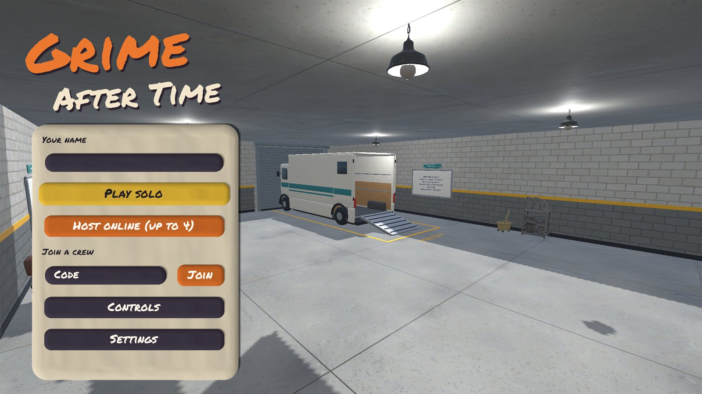
*The main menu, over the HQ*

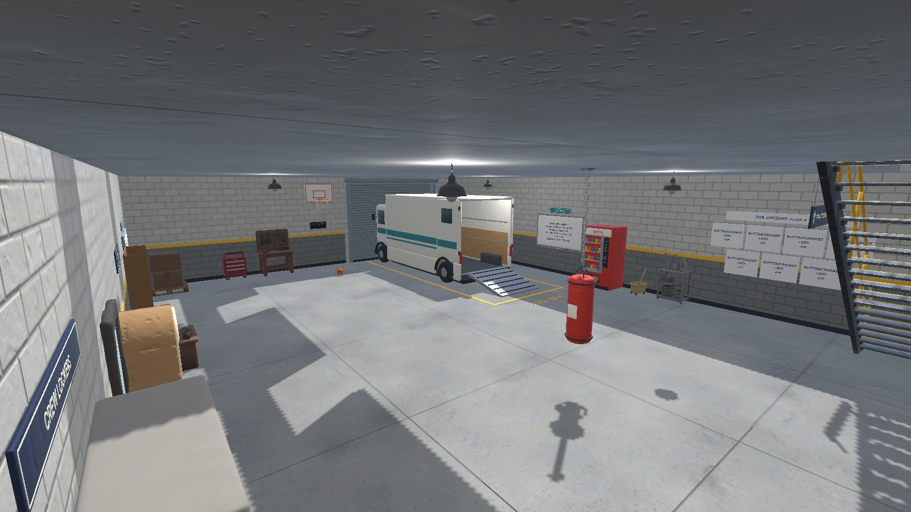
*The HQ: van, contract board, toys and lockers*

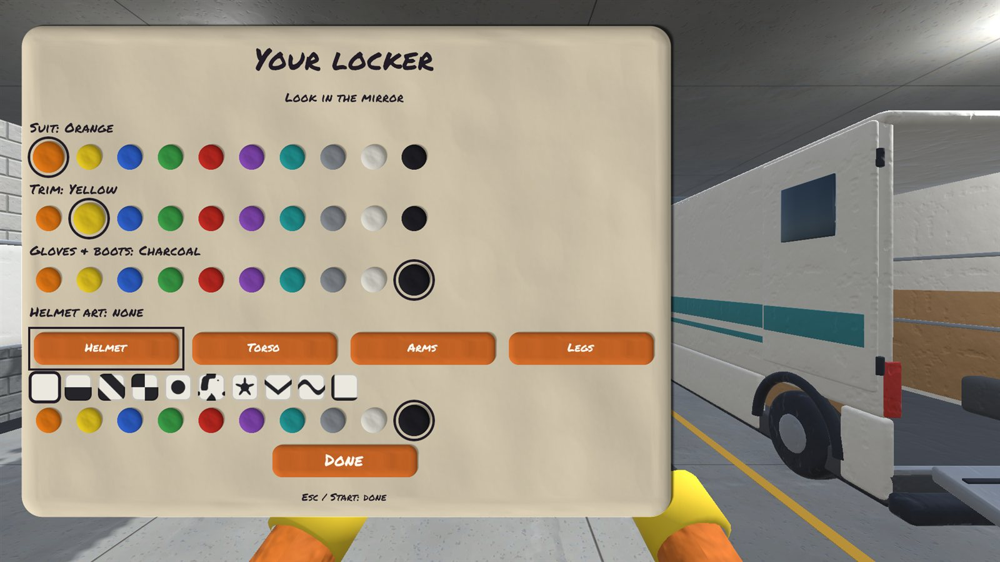
*Lockers: pick your suit colours and suit art*

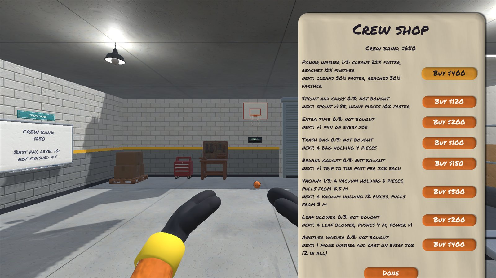
*The crew shop*

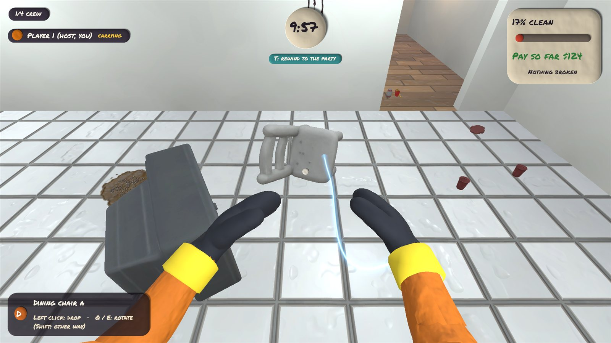
*The HUD: time and clean bars at the top left, and the hint bubble under the crosshair*

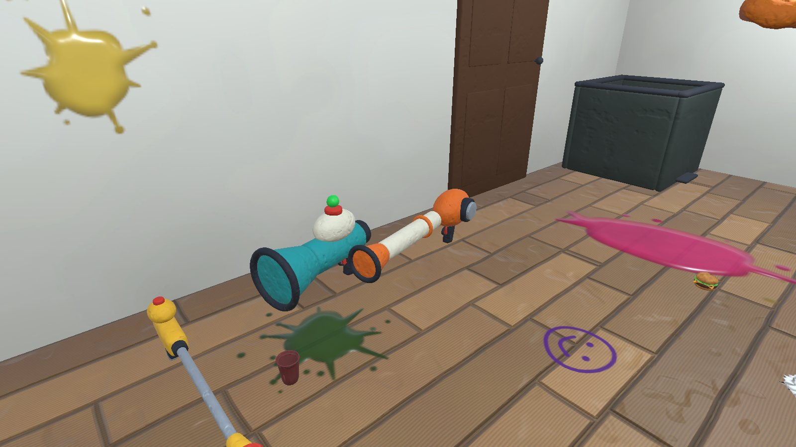
*The vacuum and the power washer*

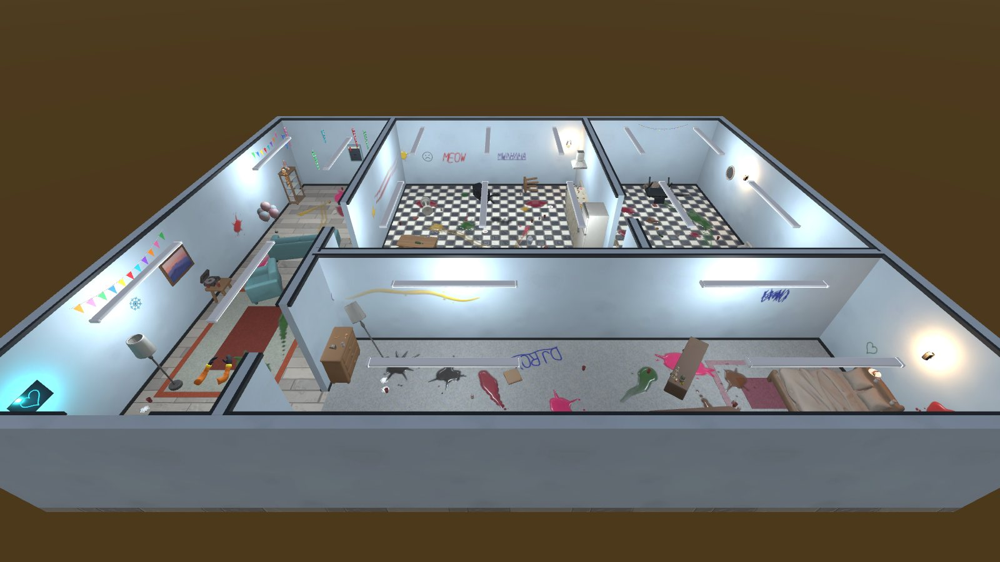
*A random party house, after the party*

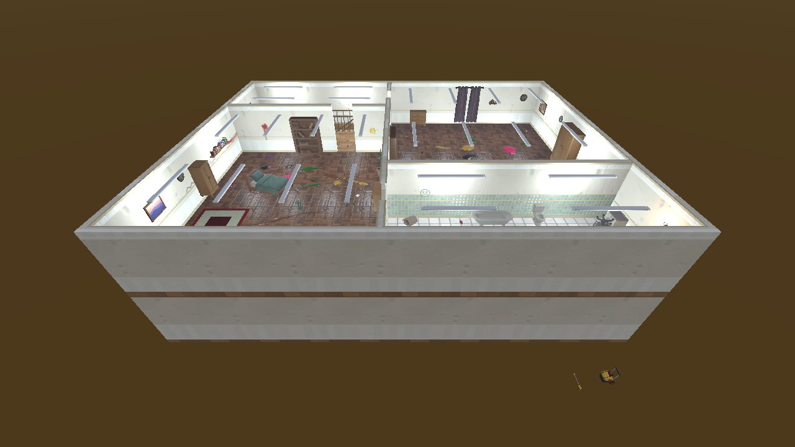
*Bigger jobs: two-storey houses*

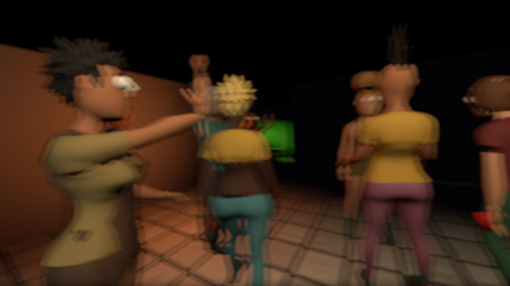
*Rewind: the party through a drunk guest's eyes*

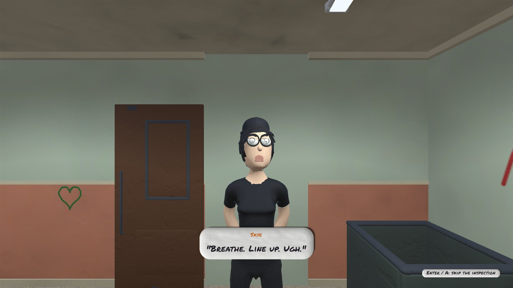
*The owner's inspection*

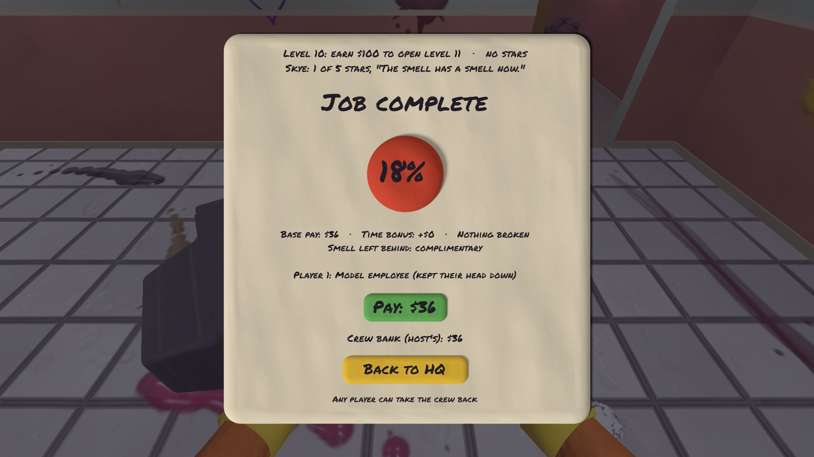
*Job complete*

## Features

> This list is kept complete: it describes everything the game can do as of the latest release.

### The job
- Every round is a **different random party**: a new floor plan, kitchen corner, interior walls, furniture, stains, trash and guests, so no two jobs look the same.
- **Clean up**: wash away stains, bin the trash, and carry furniture and ornaments back to where they stood before the party.
- Your **pay** depends on how clean the house is and how close each piece is to its original spot. Finish early for a bonus; the owner arrives at the 10-minute mark and takes a cut for the wait.
- A **1 to 3 star rating** for each job (pass, 80%, 95% before the owner arrives), with your best stars and fastest pass kept for every level.
- **Style bonuses** for trick shots into the bin, bin streaks and clutch saves of falling items, with on-screen call-outs.
- **Job modifiers** you can add for extra pay: Blackout, Rush, No rewind, Fragile house, Butterfingers and Drunk crew.
- A **daily job** with its own seed and level, the same for everyone that day.
- Levels scale with difficulty: small one-room jobs up to big multi-room, two-storey houses with stairs. Harder levels have more furniture, trash and stains, and fewer rewinds.

### Time travel
- A **rewind gadget** sends you back into the party to watch what happened from the guests' own eyes and see where things belonged. Switch between guests, and watch the party lights sweep the dance floor and the music play.
- The past is drunk and dark: double vision, moving-head lights and no furniture moving, so you can learn the original layout. Others on your crew see you as a clay ball while you are away.
- Your crew can talk to you across time: **proximity voice chat** with a ghostly effect between the past and the present.

### Cleaning and chaos
- Tools: a **power washer** with an 8 m hose, a vacuum, a leaf blower and the house bin (plus trash bags you can buy).
- **Grab** things with a stretchy clay rope, throw them, and bonk trash off your crew.
- The chaos is part of the game: washer knockback, wet floors that make you slip, the hose tripping you, clay flops, banana peels, dragging a crewmate by the rope and even **binning them**.
- At the end of the job the crew is lined up for the **owner's inspection**: one of ten mean owners walks every room, then slaps a random player if the house is below the pass mark, and hands over the cash.
- A **sliding front door** you hold open for the owner, and an invoice that blames players for broken items.

### Co-op
- Play **solo or with up to 4 players online**. One player hosts and shares a join code; there is no port forwarding.
- Pay goes into a shared crew bank. Everyone shares the job clock, the mess and the score.

### The HQ
A walk-around hangout between jobs:
- The **van** you all walk into to start a job, and a contract board with the job cards and modifiers.
- **Crew shop**: crew-wide upgrades for the washer, sprint and carry strength, extra time and the trash bag, in three tiers each.
- Boards for money, local records and achievements; a **trophy shelf**; **20 achievements** with crew ranks shown on your name tag; and the owners' reviews of your work.
- Practice stations for the washer, placing furniture and binning trash.
- Toys: a basketball hoop, a jukebox, a punch bag and a vending machine.
- **Lockers and a mirror** to change how you look.

### Your look
- Everyone wears a clay cleaning suit with a dark visor. Choose three colours (suit, trim, gloves and boots) from ten swatches, type your own nickname, and decorate the suit with **preset art**: ten patterns (stripes, hazard, checker, dots, camo, stars, zigzag, waves, grid) and an ink colour for each of the helmet, torso, arms and legs.

### The HUD
- A small white card at the top left shows two bars: **time left** (a clock) and **how clean the house is** (a sparkle). The time bar turns red in the last minute.
- **Hold Tab** (gamepad: Back / View) to open the card with the numbers and your crew list.
- A **speech bubble under the crosshair** names what you are looking at ("Furniture: Dining Chair | Durability: 3/3"). The crosshair turns **yellow on furniture and red on trash**, also while you carry it.

### Sound and look
- A handcrafted **clay look** for the characters and props, and a clay-style menu and HUD.
- Sound effects, menu music, a different party track in each past, and lo-fi music while you clean. The settings screen has Music and Sound effects sliders.
- Keyboard and mouse, or a gamepad.

## Playing
- Windows 64-bit PC. Unzip first; do not run it from inside the zip.
- Play solo with **Play solo**. To play with friends, one person picks **Host online (up to 4)** and shares the code; the others type it under **Join a crew** and press **Join**. Your saved game (levels, money, upgrades, trophies) is kept between sessions.
- Found a bug or have an idea? Tell whoever sent you the build.
